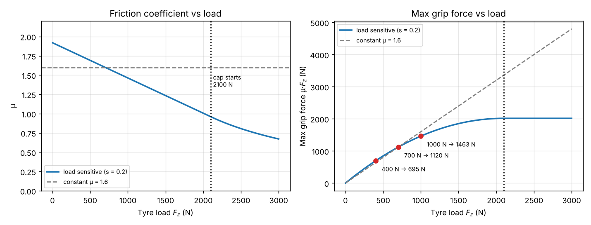
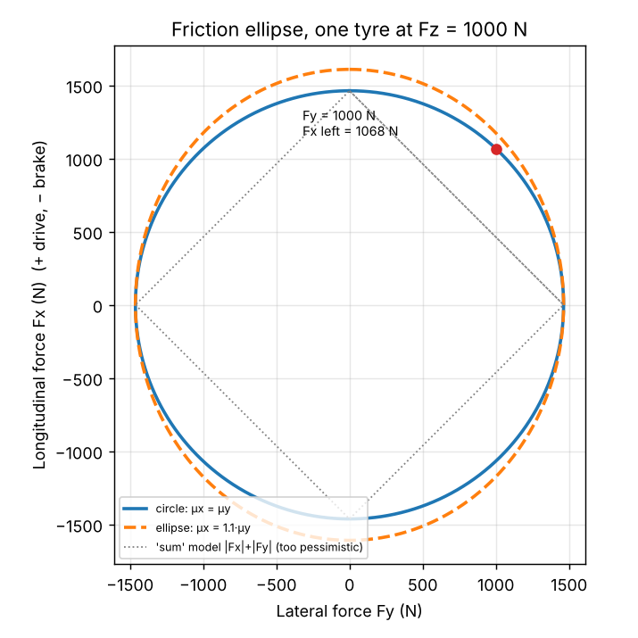

# 14. Tyre Grip: Load Sensitivity and the Friction Ellipse

Docs/03 gives each tyre one constant friction coefficient, so the maximum grip force is $\mu \cdot F_z$
and doubles when the load doubles. Real tyres do not do that, and two things are missing:

* **Load sensitivity.** More load gives more grip force, but less than proportionally, so $\mu$
  drops as the load rises.
* **The friction ellipse.** A tyre has one friction budget. Braking or driving force uses part of
  it, and the cornering force gets what is left.

This document only gives the **maximum** force a tyre can make (the grip limit). It does not model
how the force builds up with slip angle or slip ratio. That is not needed for a quasi-steady-state
(QSS) lap, which only asks "how much can the tyre give at most". How the lateral force is shared
between the four tyres in a corner (lateral load transfer) belongs to the cornering document. There
is no anti-roll bar in the car, and none is added here.

---

## 14.1. Symbols

Same conventions as docs/11 and docs/13. New symbols:
* $F_z$ is the vertical load on one tyre in Newtons (N), from docs/11 equation 11.9 (it already includes downforce, docs/13),
* $F_{z,ref}$ is the reference load in Newtons (N), a load where the tyre was measured, typically the static corner load,
* $\mu_{x,ref}$ is the longitudinal (braking and driving) friction coefficient at $F_{z,ref}$, dimensionless,
* $\mu_{y,ref}$ is the lateral (cornering) friction coefficient at $F_{z,ref}$, dimensionless,
* $\lambda$ is the load sensitivity, dimensionless: the fraction by which $\mu$ drops when the load rises by $F_{z,ref}$,
* $\mu_x(F_z)$, $\mu_y(F_z)$ are the friction coefficients at load $F_z$, dimensionless,
* $F_{x,max}$, $F_{y,max}$ are the maximum longitudinal and lateral forces of one tyre in Newtons (N),
* $F_x$, $F_y$ are the longitudinal and lateral forces the tyre actually makes in Newtons (N).

---

## 14.2. Load Sensitivity

The rubber grips the road through a small contact patch. Pressing harder makes the patch larger and
gives more force, but the rubber does not keep up, so the force per Newton of load falls. The
simplest model that captures this is a straight line for $\mu$:

$$\mu_x(F_z) = \mu_{x,ref} \cdot \left( 1 - \lambda \cdot \frac{F_z - F_{z,ref}}{F_{z,ref}} \right) \tag{14.1.}$$

$$\mu_y(F_z) = \mu_{y,ref} \cdot \left( 1 - \lambda \cdot \frac{F_z - F_{z,ref}}{F_{z,ref}} \right) \tag{14.2.}$$

The same $\lambda$ is used in both directions, so the shape of the ellipse (section 14.4) does not
change with load. $\lambda = 0$ gives back the constant $\mu$ of docs/03.

Example: $\lambda = 0.2$ means that at twice the reference load, $\mu$ is 20 % lower.

The maximum forces are:

$$F_{x,max} = \mu_x(F_z) \cdot F_z \tag{14.3.}$$

$$F_{y,max} = \mu_y(F_z) \cdot F_z \tag{14.4.}$$

Placeholder FS values in the graph: $\mu_{ref} = 1.6$, $F_{z,ref} = 700$ N, $\lambda = 0.2$.

**The cap.** Put 14.1 into 14.3 and $F_{x,max}$ is a parabola in $F_z$. Past its top it would fall
as the load rises, which real tyres do not do in their working range. Setting the slope to zero
gives the load where the top is:

$$F_{z,peak} = \frac{1 + \lambda}{2 \cdot \lambda} \cdot F_{z,ref} \tag{14.5.}$$

Above $F_{z,peak}$ the force is held at its value at $F_{z,peak}$. With the values above,
$F_{z,peak} = 2100$ N, three times the reference load, so a normal FS car never gets there. The cap
only stops nonsense if someone types a large $\lambda$.

**Zero load.** $F_z = 0$ (lifted wheel, docs/11 equation 11.10) gives $F_{x,max} = F_{y,max} = 0$.

---

## 14.3. Why It Matters: Two Tyres Sharing a Load

Take the two tyres of one axle, each with 700 N, and move 300 N from one to the other (load
transfer). Values from section 14.2, $\mu_{ref} = 1.6$, $F_{z,ref} = 700$ N, $\lambda = 0.2$.

No transfer, each tyre:

$$F_{max} = 1.6 \cdot 700 = 1120 \text{ N}, \qquad \text{axle: } 2240 \text{ N}$$

Outside tyre, 1000 N:

$$\mu = 1.6 \cdot \left( 1 - 0.2 \cdot \frac{300}{700} \right) = 1.463, \qquad F_{max} = 1463 \text{ N}$$

Inside tyre, 400 N:

$$\mu = 1.6 \cdot \left( 1 + 0.2 \cdot \frac{300}{700} \right) = 1.737, \qquad F_{max} = 695 \text{ N}$$

Axle:

$$1463 + 695 = 2158 \text{ N}$$

The axle has lost 82 N (3.7 %) although the total load is the same. The outside tyre gains less
than the inside tyre loses, because the force curve in the graph bends down.

In general, for two tyres that start at the same load and move $\Delta F_z$ between them:

$$\Delta F_{axle} = -2 \cdot \frac{\mu_{ref} \cdot \lambda}{F_{z,ref}} \cdot \Delta F_z^2 \tag{14.6.}$$

Check:

$$2 \cdot \frac{1.6 \cdot 0.2}{700} \cdot 300^2 = 82 \text{ N}$$

The loss grows with the **square** of the transfer. This is why load transfer changes the balance
of the car: the axle that takes more of the lateral transfer loses more grip. With $\lambda = 0$
the loss is zero, and roll would not affect the lap time at all.

The same bend works for downforce: 300 N of downforce on a 700 N tyre gives +343 N of grip, not the
+480 N a constant $\mu$ would give.

---

## 14.4. The Friction Ellipse

A tyre that brakes and corners at the same time cannot give the full maximum in both directions.
The model is:

$$\left( \frac{F_x}{F_{x,max}} \right)^2 + \left( \frac{F_y}{F_{y,max}} \right)^2 \le 1 \tag{14.7.}$$

Both maxima come from 14.3 and 14.4 at the tyre's current load. When the cornering force $F_y$ is
known, the longitudinal force that is left is:

$$F_{x,avail} = F_{x,max} \cdot \sqrt{1 - \left( \frac{F_y}{F_{y,max}} \right)^2} \tag{14.8.}$$

If $|F_y| > F_{y,max}$, the tyre cannot hold the corner. In the QSS lap that is how the maximum
corner speed is found (cornering document).

Example, one tyre at 1000 N, $\mu_x = \mu_y = 1.463$, so $F_{x,max} = F_{y,max} = 1463$ N. The
corner needs $F_y = 1000$ N:

$$F_{x,avail} = 1463 \cdot \sqrt{1 - \left( \frac{1000}{1463} \right)^2} = 1068 \text{ N}$$

Using 68 % of the lateral grip still leaves 73 % for braking. That is why a driver can brake into a
corner (trail braking). A simpler "sum" model, $|F_x| + |F_y| \le F_{max}$, would leave only 463 N.

**Longitudinal or lateral, which is bigger?** In tyre test data the peak $\mu_x$ is often a little
higher than $\mu_y$, typically 0 to 15 %, but not always. With $\mu_{x,ref} = \mu_{y,ref}$ the
ellipse is a circle. The car is usually limited by the engine (accelerating) or by the brake balance
(braking) before it reaches $\mu_x$, so the exact ratio matters less than $\mu_y$ and $\lambda$.

**Recommendation:** keep $\mu_{x,ref}$ and $\mu_{y,ref}$ as two separate tyre values, and set them
equal (a circle) until FS RTU has measured tyre data. Changing the ratio later is then a data
change, not a code change.

---

## 14.5. Implementation in the Simulation Lifecycle

1. The four corner loads $F_z$ come from docs/11 (`calculate_corner_tyre_loads` in
   `calculate_step_loads`). They already include downforce and longitudinal load transfer
   (docs/13), so nothing new is needed for the loads.
2. The grip limit is calculated **per tyre** with 14.1 to 14.5 (`calculate_max_tyre_force`) and
   14.8 (`calculate_available_longitudinal_force`), then summed per axle (`calculate_axle_grip`,
   stored in `StepLoads::axle_grip`). Summing the loads first and applying $\mu$ to the axle load
   would hide the effect of section 14.3.
3. Traction and braking are limited by the axle sums of $F_{x,avail}$ (`calculate_split_force_limit`,
   docs/09 and docs/10).

In today's straight-line simulation $F_y = 0$, so $F_{x,avail} = F_{x,max}$, and the left and right
tyres carry the same load. The only change on the straight is that $\mu$ now depends on the load.
The ellipse starts to matter when the cornering step gives $F_y \neq 0$.

---

## 14.6. Tyre File Values

Keys in `data/tyres/*.toml` (they replace the old `mu_static`):

| Key | Unit | Meaning |
|---|---|---|
| `mu_x_ref` | | Longitudinal peak $\mu$ at the reference load |
| `mu_y_ref` | | Lateral peak $\mu$ at the reference load |
| `reference_load_N` | N | Load where both $\mu$ values apply, > 0 |
| `load_sensitivity` | | $\lambda$, >= 0. 0 = constant $\mu$ |

`tyres/baseline.toml` has `mu_x_ref = mu_y_ref = 0.9` (the old `mu_static`), `reference_load_N = 2000`
(the static corner load of the baseline car) and `load_sensitivity = 0`, so the baseline run gives
exactly the same results as before.
A separate FS placeholder tyre file could use $\mu = 1.6$, 700 N, $\lambda = 0.2$ until real data
replaces it.

---

## 14.7. Tests

* $\lambda = 0$: $F_{x,max} = \mu_{x,ref} \cdot F_z$ at any load (back to docs/03).
* At $F_z = F_{z,ref}$: $\mu = \mu_{ref}$ for any $\lambda$.
* Section 14.3 example: axle grip 2158 N, loss 82 N, matching 14.6.
* Cap: $F_{x,max}$ never decreases as $F_z$ rises, and it is constant above $F_{z,peak}$.
* $F_z = 0$ gives zero grip.
* Ellipse with $F_y = 0$ gives $F_{x,max}$. With $F_y = F_{y,max}$ it gives 0. Section 14.4 example gives 1068 N.
* Baseline run unchanged (same results as before this step).

---

## 14.8. Limitations

[!WARNING]
Only peak forces are modelled: no slip angle or slip ratio curves (Pacejka), so no transient tyre
behaviour. $\mu$ is linear in load with the same $\lambda$ in both directions. Tyre temperature,
pressure, camber, wear and the speed of the car do not change grip. The ellipse is an approximation
of the real combined-slip shape. Roll stiffness and anti-roll bars are not modelled, so the
front/rear split of lateral load transfer comes later (cornering document).
