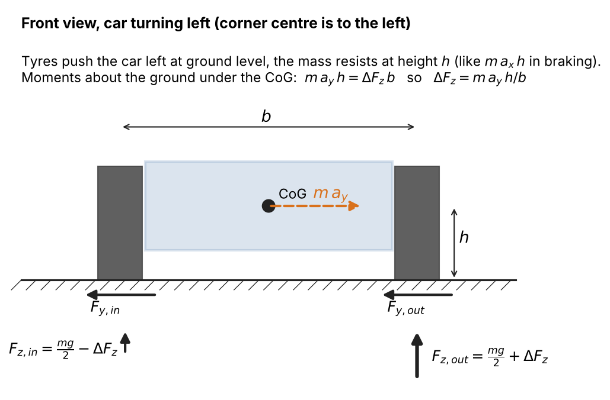
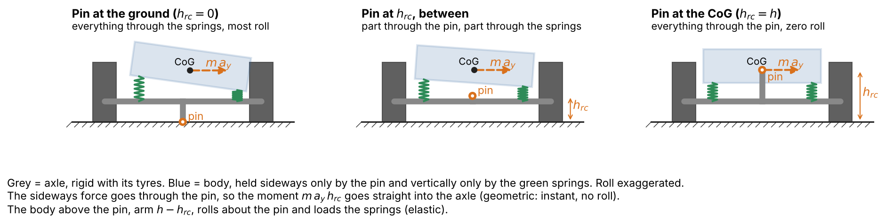
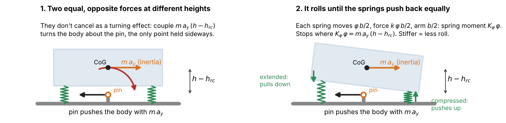
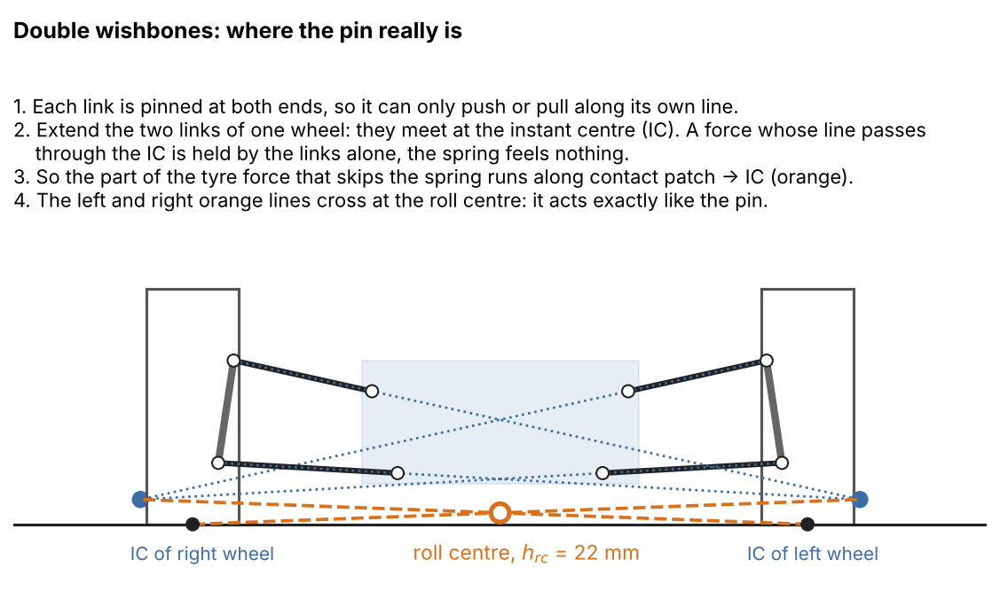
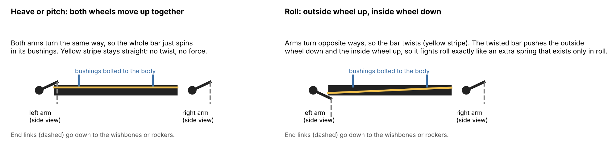

# 19. Roll and Lateral Load Transfer

Docs/16 made the car corner, but the left and right tyre of an axle always carry the same load.
A real car does not work that way. In a corner the outside tyres carry more load and the inside
tyres less, the body **rolls** towards the outside, and with load-sensitive tyres (docs/14) that
costs grip. How the extra load is shared between the front and the rear axle sets the balance
of the car: the axle that takes more of it loses more grip and lets go first. Anti-roll bars
are the tool to set that share.

This document adds:
* track widths, so lateral load transfer can be calculated at all,
* **roll** as a third body motion next to heave and pitch (docs/11), with its own inertia, the
  existing corner springs and dampers, and an anti-roll bar per axle,
* roll centres (optional): the part of the transfer that goes through the suspension links
  instead of the springs,
* frame torsional stiffness (optional): a frame that twists lets the front and rear of the body
  roll by different angles, which weakens the anti-roll bars,
* a new rule for how the two tyres of an axle share the axle's lateral force,
* lateral load transfer in the corner speed limit (docs/16).

Once the roll motion settles, the tyre loads are exactly the steady-state formulas of
section 19.7, the same way docs/11 settles to docs/10.

---

## 19.1. Symbols and Sign Convention

Same conventions as docs/11. New symbols:

Geometry:
* $b_f$, $b_r$ are the front and rear track widths (distance between the left and right contact
  patch centres) in meters (m). Not $t$, which is time.
* $h_{rc,f}$, $h_{rc,r}$ are the front and rear roll centre heights above the ground in meters (m),
* $h_{ra}$ is the height of the roll axis under the CoG in meters (m) (section 19.3).

Body roll (the new state):
* $\varphi$ is roll, the rotation of the body from its static attitude, in radians (rad),
  **positive = right side down**,
* $\omega_\varphi$ is roll rate in radians per second (rad/s),
* $\alpha_\varphi$ is roll acceleration in radians per second squared (rad/s²),
* $\varphi_f$, $\varphi_r$ are the roll of the front and the rear half of the body when the frame
  twists (section 19.8), with rates $\omega_{\varphi,f}$, $\omega_{\varphi,r}$. With a rigid frame
  $\varphi_f = \varphi_r = \varphi$.
* $J_\varphi$ is the roll moment of inertia of the body about a lengthwise axis through the CoG,
  in kilogram meters squared (kg·m²). $J$ alone stays the pitch inertia of docs/11.

Stiffness and forces:
* $K_{\varphi,f}$, $K_{\varphi,r}$ are the roll stiffness of each axle in Newton meters per radian
  (N·m/rad), springs and bar together. Capital $K$ with $\varphi$ so it is not confused with a
  wheel rate $k$.
* $K_{ch}$ is the torsional stiffness of the frame (chassis) between the front and the rear axle
  in N·m/rad (section 19.8),
* $K_{arb,f}$, $K_{arb,r}$ are the roll stiffness each anti-roll bar adds to its axle in N·m/rad,
* $F_{arb,f}$, $F_{arb,r}$ are the anti-roll bar force at each wheel of the axle in Newtons (N),
* $\Delta F_{z,f}$, $\Delta F_{z,r}$ are the load each axle moves from its inside to its outside
  tyre in Newtons (N): the outside tyre gains it and the inside tyre loses it,
* $\Delta F_{geo,f}$, $\Delta F_{geo,r}$ are the part of it that goes through the links
  (geometric) in Newtons (N),
* $\Delta F_{el,f}$, $\Delta F_{el,r}$ are the part of it that goes through the springs and bar
  (elastic) in Newtons (N).

**Lateral acceleration now has a sign.** $a_y = v^2 \cdot \bar{\kappa}$ is positive towards the
left, the same as curvature (docs/15): positive in a left turn. In docs/16 it was always
$\ge 0$. In a left turn the body rolls to the right, so $a_y > 0$ gives $\varphi > 0$. The axle
lateral forces $F_{y,f}$, $F_{y,r}$ of docs/16 get the same sign.

From earlier documents: $m$, $g$, $h$, $d_f$, $d_r$, $W$, $z$, $\theta$, $s$, $v_s$, $k$, $c$,
$F$ (docs/11), $F_y$, $F_{y,f}$, $F_{y,r}$ (docs/16), $\mu_y$, $\lambda$, $F_{z,ref}$ (docs/14).

---

## 19.2. Total Lateral Load Transfer



The same picture as braking in docs/10, turned sideways. The tyres push the car towards the
corner centre with $m \cdot a_y$ at ground level. The mass resists at the CoG, at height $h$.
A sideways push at the ground and a resistance at height $h$ tip the car towards the outside
with the moment $m \cdot a_y \cdot h$. Only the tyres can hold it: the outside tyres press
harder and the inside tyres lighter, $b$ apart.

For a car with equal track widths, the total load that moves from the inside tyres to the
outside tyres is:

$$\Delta F_{z,f} + \Delta F_{z,r} = \frac{m \cdot a_y \cdot h}{b} \tag{19.1.}$$

Only $m$, $a_y$, $h$ and $b$ are in it. Springs, anti-roll bars, dampers and roll centres
**cannot change this total** in a steady corner. They only decide how it is split between the
front and the rear axle, and how fast it gets there.

Why it matters: with load sensitivity, the outside tyre gains less grip than the inside tyre
loses. For an axle with $\pm\Delta F_z$ per tyre around a reference load, docs/14 section 14.3
gives the grip loss:

$$\text{axle grip loss} = \frac{2 \cdot \mu_{ref} \cdot \lambda \cdot \Delta F_z^2}{F_{z,ref}} \tag{19.2.}$$

It grows with $\Delta F_z^2$, so putting more of the transfer on one axle costs that axle a lot
more than it saves the other one. With $\lambda = 0$ (the baseline tyre) the grip of an axle is
$\mu$ times its load whatever the split, so lateral load transfer changes nothing about grip,
even when an inside wheel lifts.

---

## 19.3. Why the Body Rolls: the Roll Centre



**The pin model.** Think of the body as connected to each axle by only two things: a pin that
carries all the sideways force, and springs that carry the vertical force. (A solid axle with a
Panhard rod really is built like this.) The pin is at height $h_{rc}$.



Now look at the body alone. Two sideways forces act on it:
* at the CoG, its inertia $m \cdot a_y$, pointing out of the corner,
* at the pin, the links pushing it into the corner with the same $m \cdot a_y$. That push is
  what makes the body follow the axle round the corner.

They are equal and opposite, so the body does not slide sideways off the axle. But they act at
different heights, $h - h_{rc}$ apart, so together they turn the body with the moment
$m \cdot a_y \cdot (h - h_{rc})$. It turns **about the pin**, the only point where it is held
sideways. As it rolls, the outside springs compress and the inside springs extend, and they
push back. The body settles where the spring moment equals the turning moment.

This splits each axle's transfer into two paths:
* **Geometric**, below the pin: the axle's lateral force acting at $h_{rc}$ goes straight through
  the pin into the axle and the tyres. No roll, no springs, instant.
* **Elastic**, above the pin: the body rolls and the springs and bar carry it. It needs roll
  motion, so it is delayed by the roll dynamics (section 19.10).

Move the pin up and the roll gets smaller. With the pin at the CoG there is no roll at all. The
total of equation 19.1 is the same in every case.



**Where the pin is on real wishbones.** Each link is pinned at both ends, so it can only push or
pull along its own line. The two links of one wheel, extended, meet at the instant centre (IC).
A force aimed at the IC is held by the links alone: the spring does not feel it. So the part of
the tyre force that skips the spring runs along the line from the contact patch to the IC. The
left and right lines cross at the **roll centre**: the point where the wishbone geometry acts
like the pin. It is not a part of the car. It comes from the suspension pickup points, so a team
gets it from its suspension CAD or kinematics software.

**The roll axis.** The front and rear roll centres joined by a line give the roll axis. The body
rolls about this line. Under the CoG it is at height:

$$h_{ra} = \frac{d_r \cdot h_{rc,f} + d_f \cdot h_{rc,r}}{W} \tag{19.3.}$$

**Without roll centre data**, both heights are 0: the roll axis is on the ground, all the
transfer is elastic, and the roll angle comes out somewhat too large. For a Formula Student car
with $h \approx 0.3$ m and roll centres of 20 to 50 mm, about 7 to 17 % of the transfer really
goes through the links. The total is unchanged.

---

## 19.4. Roll Stiffness: Springs and Anti-Roll Bar

**Springs.** When the body rolls by $\varphi$, each wheel moves $\varphi \cdot b/2$ (up on one
side, down on the other), its spring pushes back with $k \cdot \varphi \cdot b/2$, and that
force has the arm $b/2$. Both wheels of the front axle together:

$$K_{\varphi,springs,f} = (k_{FL} + k_{FR}) \cdot \frac{b_f^2}{4} \tag{19.4.}$$

which is $k \cdot b_f^2 / 2$ for equal wheel rates. The same for the rear.



**Anti-roll bar.** A U-shaped steel bar. The straight middle part sits in two bushings bolted to
the body and can turn freely in them. The two arms connect through end links to the left and
right wishbones or rockers.
* **Heave and pitch:** both wheels move the same way, both arms turn the same way, and the whole
  bar spins in its bushings. No twist, no force.
* **Roll:** one wheel goes up and the other down, the arms turn opposite ways and the bar twists.
  A twisted bar is a torsion spring: it pushes the outside wheel down and the inside wheel up,
  so the body is held up on the outside and pulled down on the inside.

So the bar is an extra spring that only exists in roll. That is why cars use bars at all: they
control roll and set the front/rear balance without making the ride, the braking dive or the
aero ride height any stiffer. The roll stiffnesses add:

$$K_{\varphi,f} = K_{\varphi,springs,f} + K_{arb,f}, \qquad K_{\varphi,r} = K_{\varphi,springs,r} + K_{arb,r} \tag{19.5.}$$

**Bar stiffness from its dimensions.** The car file takes $K_{arb}$ directly. To get it from a
solid round bar of shear modulus $G$ (79 GPa for steel), diameter $d_{bar}$, twisting length
$L_{bar}$ and arm length $L_{arm}$, with $MR$ the end link travel per unit of wheel travel:

$$K_{bar} = \frac{G \cdot \pi \cdot d_{bar}^4}{32 \cdot L_{bar}} \tag{19.6.}$$

$$K_{arb} = K_{bar} \cdot \left( \frac{MR \cdot b}{L_{arm}} \right)^2 \tag{19.7.}$$

Equation 19.7: a roll $\varphi$ moves each end link $MR \cdot \varphi \cdot b/2$, which turns each
arm by that over $L_{arm}$, opposite ways, so the bar twists by $MR \cdot \varphi \cdot b / L_{arm}$.
The bar torque comes back to the wheels through the same lever ratio a second time, hence the
square.

Example: a 12 mm solid steel bar, 0.4 m long, 80 mm arms, $MR = 0.5$, $b = 1.2$ m:

$$K_{bar} = \frac{79 \cdot 10^9 \cdot \pi \cdot 0.012^4}{32 \cdot 0.4} = 402 \text{ N·m/rad}$$

$$K_{arb} = 402 \cdot \left( \frac{0.5 \cdot 1.2}{0.08} \right)^2 = 22\,600 \text{ N·m/rad}$$

For comparison, springs with a 25 kN/m wheel rate on the same track give
$25\,000 \cdot 1.2^2 / 2 = 18\,000$ N·m/rad. This bar more than doubles that axle's roll stiffness.

**How the bar moves load to its own axle.** With a rigid frame the body is one piece, so the
front and the rear roll by the same $\varphi$ (section 19.8 for a frame that twists). Each axle holds $K_\varphi \cdot \varphi$ of the roll moment,
like two springs side by side under one plate: the stiffer one carries more. A stiffer front
bar puts more of the elastic transfer on the front tyres, so the front loses more grip and the
car understeers. A stiffer rear bar does the same at the rear: oversteer.

---

## 19.5. Corner Compression and Corner Forces

Equation 11.4 gets the roll term. A point at sideways distance $b/2$ from the centre line moves
down by $\varphi \cdot b/2$ on the right and up by the same on the left:

$$s_{FL} = z + d_f \cdot \theta - \frac{b_f}{2} \cdot \varphi, \qquad s_{FR} = z + d_f \cdot \theta + \frac{b_f}{2} \cdot \varphi \tag{19.8.}$$

$$s_{RL} = z - d_r \cdot \theta - \frac{b_r}{2} \cdot \varphi, \qquad s_{RR} = z - d_r \cdot \theta + \frac{b_r}{2} \cdot \varphi \tag{19.9.}$$

The compression speeds are the same with $v_z$, $\omega$ and $\omega_\varphi$ in place of $z$,
$\theta$ and $\varphi$. The corners of an axle are no longer equal, so each corner now has its
own compression, speed and force. With a frame that twists, the front corners use $\varphi_f$
and the rear corners $\varphi_r$ (section 19.8).

**Anti-roll bar force.** The bar only feels the difference between the two corners of its axle.
It pushes the more compressed corner up and the other one down, equally:

$$F_{arb,f} = K_{arb,f} \cdot \frac{s_{FR} - s_{FL}}{b_f^2} \tag{19.10.}$$

added to the right corner force and subtracted from the left one. The same for the rear. In
pure roll $s_{FR} - s_{FL} = b_f \cdot \varphi$, so the two forces make the moment
$F_{arb,f} \cdot b_f = K_{arb,f} \cdot \varphi$, as section 19.4 says. In heave and pitch the
difference is 0 and the bar does nothing.

The corner force of equation 11.7 becomes:

$$F_{corner} = k \cdot s + c \cdot v_s + F_{stop}(s) \pm F_{arb} \tag{19.11.}$$

with $+$ on the right corners and $-$ on the left ones. The wheel lift clamp (11.10) is applied
to this total, and the clamped value is used for the body and the tyre, as before. The roll
damping comes from the existing corner dampers: nothing new is needed for it.

---

## 19.6. Body Equations of Motion

**Heave and pitch** do not change (equations 13.2 and 13.3). The bar forces cancel within each
axle. The geometric forces (below) push the body up on one side and down on the other by the same
amount, so they cancel too. With equal left and right wheel rates, roll does not change the
axle sums $dF_f$, $dF_r$ either.

**Roll.** Moments about the roll axis, positive right side down:
* **Lateral inertia** $+m \cdot a_y \cdot (h - h_{ra})$. The body is pushed into the corner at
  the roll axis and resists at the CoG, $h - h_{ra}$ above it (section 19.3).
* **Corner forces** $-\frac{b_f}{2} \cdot (F_{FR} - F_{FL}) - \frac{b_r}{2} \cdot (F_{RR} - F_{RL})$.
  A right corner pushing up lifts the right side, against positive roll.
* The link forces pass through the roll centres, so about the roll axis they have no moment.

$$J_{\varphi,ra} \cdot \alpha_\varphi = m \cdot a_y \cdot (h - h_{ra}) - \frac{b_f}{2} \cdot (F_{FR} - F_{FL}) - \frac{b_r}{2} \cdot (F_{RR} - F_{RL}) \tag{19.12.}$$

The body rotates about the roll axis, not about its CoG, so its inertia about that axis is the
inertia about the CoG plus the mass times the distance squared (parallel axis theorem):

$$J_{\varphi,ra} = J_\varphi + m \cdot (h - h_{ra})^2 \tag{19.13.}$$

**Tyre loads.** Equation 11.9 gets the geometric transfer, which goes straight to the tyres:

$$\Delta F_{geo,f} = \frac{F_{y,f} \cdot h_{rc,f}}{b_f}, \qquad \Delta F_{geo,r} = \frac{F_{y,r} \cdot h_{rc,r}}{b_r} \tag{19.14.}$$

$$F_{z,FR} = F_{z,static,FR} + F_{FR} + \Delta F_{geo,f}, \qquad F_{z,FL} = F_{z,static,FL} + F_{FL} - \Delta F_{geo,f} \tag{19.15.}$$

and the same for the rear. With $a_y > 0$ (left turn) the right tyres are the outside ones and
gain the load. A tyre load is never below 0. With roll centres above the ground an inside tyre
can reach 0 before its corner force is clamped: the code then clamps the tyre load at 0. At that
point the car is lifting a wheel and the model is at the end of its range anyway.

---

## 19.7. Steady State

In a constant corner, once the motion has settled, $\alpha_\varphi = 0$ and every speed is 0.
With linear springs and no stops touched, equation 19.8 gives $s_{FR} - s_{FL} = b_f \cdot \varphi$,
and the corner and bar forces add up to $(F_{FR} - F_{FL}) \cdot b_f/2 = K_{\varphi,f} \cdot \varphi$.
Equation 19.12 then gives the settled roll:

$$\varphi_{ss} = \frac{m \cdot a_y \cdot (h - h_{ra})}{K_{\varphi,f} + K_{\varphi,r}} \tag{19.16.}$$

The elastic transfer of each axle is its share of the roll moment over its track width, and the
geometric one is 19.14. Per tyre, front axle:

$$\Delta F_{z,f} = \underbrace{\frac{F_{y,f} \cdot h_{rc,f}}{b_f}}_{\text{geometric}} + \underbrace{\frac{K_{\varphi,f}}{K_{\varphi,f} + K_{\varphi,r}} \cdot \frac{m \cdot a_y \cdot (h - h_{ra})}{b_f}}_{\text{elastic}} \tag{19.17.}$$

and the same for the rear with $r$ and $f$ swapped. With $F_{y,f} = m \cdot a_y \cdot d_r / W$
(docs/16) and equal track widths, front plus rear is exactly equation 19.1. Damping and $J_\varphi$
do not appear: they only decide the path to the steady state. This is the first test of the code.

**Worked example.** Baseline car, $b_f = b_r = 1.6$ m, no downforce, $a_y = 8$ m/s² (left turn),
roll centres $h_{rc,f} = 0.05$ m, $h_{rc,r} = 0.10$ m, no bars. The car is 50/50, so
$d_f = d_r = 1.7$ m and $F_{y,f} = F_{y,r} = 815.5 \cdot 8 / 2 = 3262$ N.

$$h_{ra} = \frac{1.7 \cdot 0.05 + 1.7 \cdot 0.10}{3.4} = 0.075 \text{ m}$$

$$K_{\varphi,f} = K_{\varphi,r} = 260\,000 \cdot \frac{1.6^2}{4} = 166\,400 \text{ N·m/rad}$$

$$m \cdot a_y \cdot (h - h_{ra}) = 815.5 \cdot 8 \cdot 0.225 = 1468 \text{ N·m}$$

$$\varphi_{ss} = \frac{1468}{332\,800} = 0.00441 \text{ rad} = 0.25°$$

$$\Delta F_{z,f} = \frac{3262 \cdot 0.05}{1.6} + \frac{1}{2} \cdot \frac{1468}{1.6} = 102 + 459 = 561 \text{ N}$$

$$\Delta F_{z,r} = \frac{3262 \cdot 0.10}{1.6} + \frac{1}{2} \cdot \frac{1468}{1.6} = 204 + 459 = 663 \text{ N}$$

Check: $561 + 663 = 1224$ N $= 815.5 \cdot 8 \cdot 0.3 / 1.6$. The front tyres carry 1439 N and
2561 N, the rear tyres 1337 N and 2663 N.

Now add a front bar of $K_{arb,f} = 166\,400$ N·m/rad. The front roll stiffness doubles and the
front takes 2/3 of the elastic part:

$$\Delta F_{z,f} = 102 + \frac{2}{3} \cdot \frac{1468}{1.6} = 714 \text{ N}, \qquad \Delta F_{z,r} = 204 + \frac{1}{3} \cdot \frac{1468}{1.6} = 510 \text{ N}$$

and the roll drops to $1468 / 499\,200 = 0.17°$. With $\lambda = 0.2$, $\mu_{ref} = 0.9$ and
$F_{z,ref} = 2000$ N, equation 19.2 gives a front grip loss of 92 N instead of 57 N and a rear one
of 47 N instead of 79 N: the balance moves towards understeer.

---

## 19.8. Frame Torsional Stiffness (Optional)

Sections 19.5 to 19.7 treat the frame as rigid. A real frame twists a little, like a long
torsion bar between the front and the rear suspension. Then the front and rear halves of the body
roll by different angles, $\varphi_f$ and $\varphi_r$, and the frame pushes them back towards each
other with the moment $K_{ch} \cdot (\varphi_f - \varphi_r)$.

**Leaving it out.** Without the key the frame is rigid: one roll angle, equations 19.12 and
19.13, exactly as above. A rigid frame is the limit of a very stiff one, so leaving the key out is
the right choice whenever the frame is much stiffer than the suspension (section below). Do not
put a huge number in instead: it makes a very fast twist oscillation that the time step cannot
follow (section 19.10).

**Two halves.** The body is split at the CoG into a front half that carries the front axle's
share of the mass, $m_{front}$ (the car file's `front_kg`), and a rear half with $m_{rear}$. Each
half rolls about its own roll centre, and each has its CoG at height $h$. Its roll moment is its
own mass times $a_y$ times its height above its roll centre:

$$M_f = m_{front} \cdot a_y \cdot (h - h_{rc,f}), \qquad M_r = m_{rear} \cdot a_y \cdot (h - h_{rc,r}) \tag{19.18.}$$

Together they are exactly $m \cdot a_y \cdot (h - h_{ra})$ of equation 19.12, because
$m_{front} = m \cdot d_r / W$. The roll inertia is split the same way, each about its own roll
centre:

$$J_{\varphi,f} = J_\varphi \cdot \frac{m_{front}}{m} + m_{front} \cdot (h - h_{rc,f})^2, \qquad J_{\varphi,r} = J_\varphi \cdot \frac{m_{rear}}{m} + m_{rear} \cdot (h - h_{rc,r})^2 \tag{19.19.}$$

**Equations of motion.** Each half has equation 19.12 with only its own axle, plus the frame. A
front half rolled more than the rear one twists the frame, which pushes the front back and pulls
the rear along:

$$J_{\varphi,f} \cdot \alpha_{\varphi,f} = M_f - \frac{b_f}{2} \cdot (F_{FR} - F_{FL}) - K_{ch} \cdot (\varphi_f - \varphi_r) \tag{19.20.}$$

$$J_{\varphi,r} \cdot \alpha_{\varphi,r} = M_r - \frac{b_r}{2} \cdot (F_{RR} - F_{RL}) + K_{ch} \cdot (\varphi_f - \varphi_r) \tag{19.21.}$$

The frame moments cancel when the two are added, so the frame never changes the total. The
frame's own damping is ignored: the twist is damped through the corner dampers.

**Steady state.** With all speeds 0 and linear springs, equations 19.20 and 19.21 become two
linear equations:

$$(K_{\varphi,f} + K_{ch}) \cdot \varphi_f - K_{ch} \cdot \varphi_r = M_f, \qquad -K_{ch} \cdot \varphi_f + (K_{\varphi,r} + K_{ch}) \cdot \varphi_r = M_r$$

$$\varphi_f = \frac{M_f \cdot (K_{\varphi,r} + K_{ch}) + M_r \cdot K_{ch}}{D}, \qquad \varphi_r = \frac{M_r \cdot (K_{\varphi,f} + K_{ch}) + M_f \cdot K_{ch}}{D}, \qquad D = K_{\varphi,f} \cdot K_{\varphi,r} + K_{ch} \cdot (K_{\varphi,f} + K_{\varphi,r}) \tag{19.22.}$$

and the elastic transfer of each axle is its own roll stiffness times its own roll angle, over its
track width: $\Delta F_{el,f} = K_{\varphi,f} \cdot \varphi_f / b_f$. The geometric part (19.14) does
not change. The two limits:
* $K_{ch} \to \infty$: $\varphi_f = \varphi_r$, and 19.22 becomes 19.16 and 19.17.
* $K_{ch} \to 0$: each half holds only its own moment, $\varphi_f = M_f / K_{\varphi,f}$, so the front
  elastic transfer is $M_f / b_f$ whatever the bars are. The bars no longer move load between the
  axles: they only reduce roll.

**Example.** The baseline car of section 19.7 without roll centres, with the front bar
($K_{\varphi,f} = 332\,800$, $K_{\varphi,r} = 166\,400$ N·m/rad), $a_y = 8$ m/s², so
$M_f = M_r = 407.7 \cdot 8 \cdot 0.3 = 978.6$ N·m. Rigid frame: the front takes 2/3 of the
1957 N·m, 815 N per tyre, the rear 408 N. Now a frame of $K_{ch} = 499\,200$ N·m/rad, as stiff as
both axles together:

$$D = 332\,800 \cdot 166\,400 + 499\,200 \cdot 499\,200 = 3.046 \cdot 10^{11}$$

$$\varphi_f = \frac{978.6 \cdot 665\,600 + 978.6 \cdot 499\,200}{D} = 0.003743 \text{ rad}, \qquad \varphi_r = \frac{978.6 \cdot 832\,000 + 978.6 \cdot 499\,200}{D} = 0.004277 \text{ rad}$$

$$\Delta F_{z,f} = \frac{332\,800 \cdot 0.003743}{1.6} = 778 \text{ N}, \qquad \Delta F_{z,r} = \frac{166\,400 \cdot 0.004277}{1.6} = 445 \text{ N}$$

The total is still 1223 N, but the front share fell from 66.7 % to 63.6 %. The bar was meant to
move the front share from 50 % to 66.7 %, and about a fifth of that was lost in the twisting
frame. The usual advice is a frame several times stiffer than the total roll stiffness. Formula
Student spaceframes are often 1000 to 4000 N·m/deg (57 000 to 229 000 N·m/rad), so for an FS car
this matters.

**Twist frequency.** With a flexible frame there are two roll oscillations: both halves rolling
together (close to 19.25) and the frame twisting, front against rear, which is faster. The code
finds both from the 2 × 2 system, with $a = (K_{\varphi,f} + K_{ch}) / J_{\varphi,f}$ and
$d = (K_{\varphi,r} + K_{ch}) / J_{\varphi,r}$:

$$\omega^2 = \frac{a + d}{2} \pm \sqrt{\left( \frac{a - d}{2} \right)^2 + \frac{K_{ch}^2}{J_{\varphi,f} \cdot J_{\varphi,r}}} \tag{19.23.}$$

Baseline (no bars, no roll centres, $J_{\varphi,f} = J_{\varphi,r} = 125 + 407.7 \cdot 0.3^2 = 162$ kg·m²)
with $K_{ch} = 499\,200$ N·m/rad: 32.1 rad/s together and 84.9 rad/s twisting (13.5 Hz). The
stability check (section 19.10) uses the larger one.

---

## 19.9. How the Two Tyres of an Axle Share Its Lateral Force

Docs/16 gave each tyre half of its axle's lateral force. With equal loads that was right. With
load transfer it is not: the inside tyre carries less load and cannot make half the force. Real
tyres at the same slip angle make force roughly in proportion to their load. The model uses
that idea in its simplest form: **both tyres of an axle use the same fraction of their own
lateral grip.**

$$u_{y,f} = \frac{|F_{y,f}|}{F_{y,max,FL} + F_{y,max,FR}}, \qquad F_{y,FL} = u_{y,f} \cdot F_{y,max,FL}, \qquad F_{y,FR} = u_{y,f} \cdot F_{y,max,FR} \tag{19.24.}$$

where $F_{y,max}$ is the tyre's lateral limit at its own load (docs/14). The axle is over its
limit when $u_{y,f} > 1$, which is the same as: the axle needs more than the sum of its two tyre
limits. The friction ellipse (docs/14 equation 14.8) then uses each tyre's own $F_y$ to find the
grip left for driving and braking. With equal loads both tyres get half, as before.

Example from section 19.7 without roll centres: the front tyres carry $2000 \mp 612$ N, so 1388 N
and 2612 N. With $\mu_y = 0.9$ and $\lambda = 0$ their limits are 1249 N and 2351 N, together
3600 N. The front axle needs 3262 N. Half each would be 1631 N, more than the inside tyre can
make, so the old rule would call the car over the limit. The new rule gives $u_{y,f} = 0.91$:
the axle can hold it.

**Corner speed limit.** The search of docs/16 section 16.5 now builds the tyre loads from the
constant speed axle loads (16.6 to 16.8) **plus** the steady-state transfer of equation 19.17 (or 19.22 with a flexible frame) at
the $a_y$ of the speed being tried, and checks equation 19.24. That way the planned limit
matches the loads the dynamic roll settles at. With $\lambda = 0$ the limit does not change.

---

## 19.10. Transient Behaviour

**The first instant of a corner.** The geometric part arrives at once with $a_y$. The elastic part
waits for the body to start rolling: at the first instant the whole elastic moment goes into roll
acceleration, $\alpha_\varphi = m \cdot a_y \cdot (h - h_{ra}) / J_{\varphi,ra}$, exactly like pitch
in docs/11 section 11.7. Higher roll centres make more of the transfer instant.

**Roll natural frequency and damping ratio** (rigid frame, equal corners):

$$\omega_{n,roll} = \sqrt{\frac{K_{\varphi,f} + K_{\varphi,r}}{J_{\varphi,ra}}}, \qquad \zeta_{roll} = \frac{C_{\varphi}}{2 \sqrt{(K_{\varphi,f} + K_{\varphi,r}) \cdot J_{\varphi,ra}}} \tag{19.25.}$$

with the roll damping of the four corner dampers $C_\varphi = (c_{FL} + c_{FR}) \cdot b_f^2/4 + (c_{RL} + c_{RR}) \cdot b_r^2/4$
in N·m·s/rad. The bars add stiffness but no damping, so a stiffer bar raises the frequency and
lowers $\zeta$.

Baseline with $b = 1.6$ m, no roll centres, no bars, $J_\varphi = 250$ kg·m²:
$J_{\varphi,ra} = 250 + 815.5 \cdot 0.3^2 = 323$ kg·m², $\omega_{n,roll} = 32.1$ rad/s (5.1 Hz),
$C_\varphi = 12\,800$ N·m·s/rad, $\zeta_{roll} = 0.62$.

**Time step.** The stability check of docs/11 section 11.8 now also includes $\omega_{n,roll}$, or the faster of the two
roll frequencies of 19.23 with a flexible frame,
(with the end stops when touched). At 1 ms the baseline roll gives $\omega \cdot \Delta t = 0.03$.

---

## 19.11. Implementation in the Simulation Lifecycle

The suspension state becomes $(z, v_z, \theta, \omega, \varphi_f, \omega_{\varphi,f}, \varphi_r, \omega_{\varphi,r})$.
With a rigid frame both halves are kept equal, so one code path covers both cases.

Each time step, in the order of docs/11 section 11.8:
1. $a_y = v^2 \cdot \bar{\kappa}$ (signed) and the axle lateral forces $F_{y,f}$, $F_{y,r}$
   (docs/16), from the state at the start of the step.
2. **Corner compressions and speeds** for all four corners (19.8, 19.9).
3. **Corner forces** with the bar force, end stops and wheel lift clamp (19.10, 19.11).
4. **Tyre loads** with the geometric transfer, clamped at 0 (19.14, 19.15).
5. **Lateral grip check and grip left** with the shared lateral force (19.24).
6. **Longitudinal acceleration** $a_x$ as before.
7. **Body accelerations** $a_z$, $\alpha$ and the roll accelerations: rigid frame 19.12 (the same
   $\alpha_\varphi$ for both halves), flexible frame 19.20 and 19.21.
8. **Update velocities**, then **positions with the new velocities** (semi-implicit Euler), now
   including the roll rates and angles.

Before the run (`prepare`): $h_{ra}$, $J_{\varphi,ra}$ (or $J_{\varphi,f}$, $J_{\varphi,r}$) and the roll stiffnesses, and the corner
speed limits with lateral load transfer (section 19.9).

---

## 19.12. Config, State and Log Changes

Car file, new keys:

```toml
[geometry]
front_track_width_m = 1.6
rear_track_width_m = 1.6

[suspension]
roll_inertia_kg_m2 = 250.0
# Optional, 0 when missing: roll axis on the ground, all transfer through the springs
front_roll_centre_height_m = 0.0
rear_roll_centre_height_m = 0.0
# Optional, 0 when missing (no bar). Roll stiffness the bar adds to its axle, docs/19 eq. 19.7
front_anti_roll_bar_stiffness_N_m_per_rad = 0.0
rear_anti_roll_bar_stiffness_N_m_per_rad = 0.0

# Optional: leave the whole table out for a rigid frame.
# Values in N·m/deg times 57.3 give N·m/rad.
[frame]
torsional_stiffness_N_m_per_rad = 100_000.0
```

Track widths and roll inertia are required (no sensible default). The baseline car has no
`[frame]` table (rigid), so its results only change through roll. The baseline values are
placeholders. FS RTU values replace them in the team's car file.

Run file `[initial_state.suspension]`: `roll_front_rad`, `roll_rear_rad`,
`roll_rate_front_rad_per_s` and `roll_rate_rear_rad_per_s`, optional, 0 when missing (with a rigid
frame the front and rear values must be equal), with the sign comment "roll is positive right side down".

**Change to an existing field, needs approval:** `CarState.lateral_acceleration` and the log
column `lateral_acceleration_m_per_s2` become signed (positive towards the left, as curvature)
instead of always $\ge 0$. The name stays the same.

New `CarState` values: `suspension.roll_front`, `suspension.roll_rear` and their rates. New log
columns: `roll_front_rad`, `roll_rear_rad`, `roll_rate_front_rad_per_s`, `roll_rate_rear_rad_per_s`, and the four tyre loads `tyre_load_front_left_N`, `tyre_load_front_right_N`,
`tyre_load_rear_left_N`, `tyre_load_rear_right_N`.

Version v0.13.0.

---

## 19.13. Tests

* Straight line (no curvature): roll stays exactly 0 and every result is the same as v0.12.0.
* Pure roll moves no axle load: $dF_f$, $dF_r$, heave and pitch are unchanged by a roll.
* Constant $a_y$ (skidpad): roll settles at 19.16, and the tyre loads at 19.17. Front plus rear
  transfer equals 19.1. Checked with and without roll centres and bars.
* Section 19.7 worked example: 561 N / 663 N, 0.25°. With the front bar: 714 N / 510 N, 0.17°.
* A bar does nothing in heave and pitch: same braking response with and without bars.
* Stiffer front bar: more front transfer, less rear, less roll, same total.
* Roll centres at the CoG height: no roll, all transfer geometric.
* Left and right corners mirror each other: same speed limit, roll and loads with the sign flipped.
* Roll natural frequency and damping ratio of a free roll oscillation match 19.25 (period and
  log decrement, as in docs/11).
* Undamped roll ($c = 0$): energy stays bounded.
* Bar stiffness example of section 19.4: 22 600 N·m/rad.
* Tyre sharing (19.24): equal loads give half each. The section 19.9 example is under the limit
  with the new rule.
* $\lambda = 0$: corner speed limits and lap times are the same as v0.12.0.
* $\lambda > 0$: the corner speed limit drops with lateral transfer, and a stiffer front bar
  lowers the front-limited speed.
* No `[frame]` table: front and rear roll stay equal. A very stiff frame (small time step) gives
  the same loads as no table.
* Section 19.8 example: 778 N / 445 N, front share 63.6 %. A very soft frame: each axle carries
  only its own half's moment, and changing a bar no longer moves load between the axles.
* Twist frequency of a free oscillation matches 19.23.
* An inside wheel lifts at the right $a_y$ with a very stiff bar, and its tyre load stays at 0.

---

## 19.14. Limitations

[!WARNING]
The flexible frame is one torsion spring between two body halves, each with its CoG at height $h$;
the frame's own damping and its bending are ignored. Roll centres
are fixed points: in reality they move as the car rolls and heaves. Jacking (the body lifting
from the link forces when the roll centres are above the ground) is ignored. The whole car is
still treated as sprung mass, so the transfer through the unsprung mass at wheel-centre height is
routed through the springs. Camber change with roll, the small extra roll moment from gravity when
the CoG moves sideways ($m \cdot g \cdot (h - h_{ra}) \cdot \varphi$, 5 to 7 % for the baseline),
and tyre vertical stiffness are not modelled. The car still has no steering, yaw or slip angle:
it is always on the line, so $a_y$ comes straight from speed and curvature.
